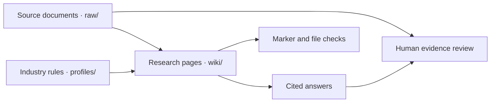

# company-wiki

A Markdown research wiki for analysts and solo operators who want to connect financial results to operating events while keeping a trail back to the evidence. For example, **what happened to revenue in the quarter Arc-A began shipping?** In the fictional example, GAAP revenue rose from USD 10 million to USD 12 million, a 20% increase. Shipments began that quarter, but the release gives no product revenue breakdown. The [prepared answer](examples/semiconductors/answer.md) shows what the evidence can establish and where it runs out.

## Run the offline demo

From a fresh checkout with Python 3.11 or later:

```sh
python scripts/demo.py
```

The command validates marker syntax and source paths, then displays the synthetic release, company page, quarter page and prepared Q&A. It reads checked-in Markdown and uses only the Python standard library. It needs no network, credentials, AWS or OpenCode. The answers are written in advance.

Follow the [synthetic release](raw/synthetic/darc-2026-q1.md) to the [quarter page](wiki/quarters/darc-2026-q1.md), then read the [prepared answer](examples/semiconductors/answer.md). Compare the reported figures with the 20% calculation, then see how the answer handles the causal question. This text walkthrough is the demo guide.

## How the wiki fits together



- **Direct** means the cited source states the fact explicitly.
- **Synthesis** means the author combined facts or calculated a result from them.
- **Assessment** means the author made an interpretive judgment, such as whether the available evidence supports a causal conclusion.
- **Unverified** means the author could not confirm the claim.

The original NVIDIA pages and filings remain alongside the two clearly labeled synthetic examples.

## Select an industry

```sh
python scripts/demo.py --profile water-utilities
```

Profiles use a versioned TOML format. [Semiconductors](profiles/semiconductors.toml) is the default and defines coverage, page frontmatter and GAAP conventions. [Water utilities](profiles/water-utilities.toml) illustrates how to use the same workflow for operating revenue, distribution losses and a pilot project. The demo command uses the profile's `[demo]` paths to select what to validate and display.

For research, name the profile explicitly in your OpenCode prompt and ask it to read the `[research]` section before ingesting or answering. To add an industry, copy a profile, define its coverage and conventions, and review which metrics, sources, page templates and sector rules need to change. The research rules guide the operator or agent. The Python validator is shared and does not enforce industry policy.

## Optional OpenCode workflow

Start OpenCode in the repository root with a model configured. [AGENTS.md](AGENTS.md) describes the shared rules. Use a named source and scope for ingest, for example, "Ingest `raw/synthetic/darc-2026-q1.md` using `profiles/semiconductors.toml`; show the proposed wiki diff." Review the resulting company index, quarter page, claim markers and references against the release before accepting edits.

For query, ask "Using `profiles/semiconductors.toml` and the DARC wiki pages, what happened to revenue when Arc-A began shipping? Cite the quarter page and flag missing evidence." The output is a draft answer with wiki citations. Check it against the cited material and record what the sources cannot establish. The [evaluation guide](examples/evaluation.md) has prompts and a review procedure.

## Optional S3 sync and Terraform

With Bash and the AWS CLI, copy `.env.example` to `.env` and set `BUCKET`, or export `BUCKET` in your shell. Use the AWS CLI credential chain, such as `AWS_PROFILE` pointing to an authenticated SSO profile. Export `AWS_PROFILE` or set it in `.env`; the legacy `PROFILE` setting is also accepted and takes precedence. Keep local credential settings out of Git.

```sh
bash scripts/sync-down.sh  # retrieve raw/ and wiki/ before editing
bash scripts/sync-up.sh    # upload reviewed local edits
```

Terraform manages the private, versioned S3 bucket and its access policy. The provider uses the operator's standard AWS credentials. Set `existing_role_name` to attach the S3 policy to an existing IAM role, or leave it unset to manage access separately. If you maintain a deployment from the old configuration, review its state and migration plan before applying changes. The removed IAM user and key were previously managed by Terraform.

To validate locally, initialize the AWS provider with the backend disabled, then validate. Initialization may need network access to download the provider. These commands require no AWS credentials.

```sh
terraform -chdir=terraform fmt -check
terraform -chdir=terraform init -backend=false
terraform -chdir=terraform validate
```

## Checks and project status

```sh
python -m unittest discover -s tests
python scripts/lint_markers.py
python scripts/demo.py
python scripts/demo.py --profile water-utilities
```

GitHub Actions runs these same commands on pushes and pull requests. The validator checks recognizable marker syntax and local files referenced by direct and synthesis markers. It reports file and line for a violation. Humans review missing markers, Markdown links, source quality, financial basis, contradictions and whether the cited source supports the claim.

The repository is a CLI portfolio project with existing semiconductor research, prepared demos for two industries and an optional agent workflow. The [evaluation log](examples/evaluation.md) records manual review of the prepared examples. Live model behavior and source accuracy across the full wiki still require review.
